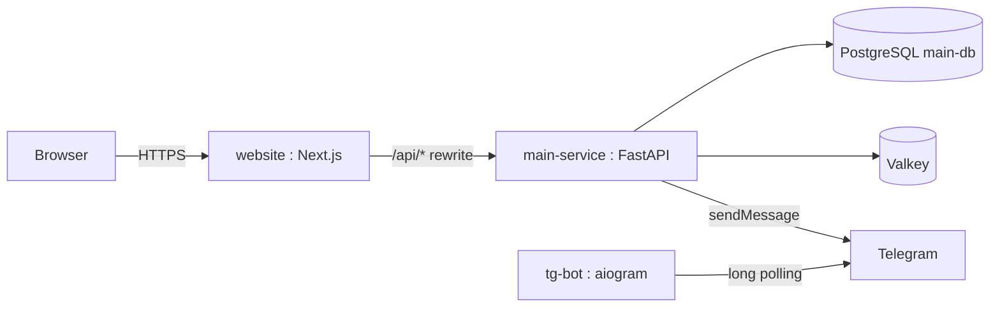

# Architecture

## Services

## Networks

- Dev: `main-network-dev`. Frontend runs on host, infra in Docker.
- Prod: `main-network`. Everything containerised behind Traefik.

## Boundaries

- **main-service** — auth, users, content. Owns `main_db`, runs Alembic
  migrations, sends mail.
- **website** — Next.js. Talks to the API through the `/api/*` rewrite
  in `next.config.ts`. Never touches the DB.
- **tg-bot** — stateless long-polling bot. Talks to Telegram only.

## Data ownership

Only **main-service** writes to `main_db`.
