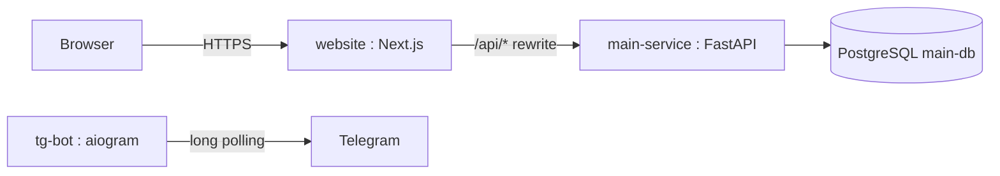
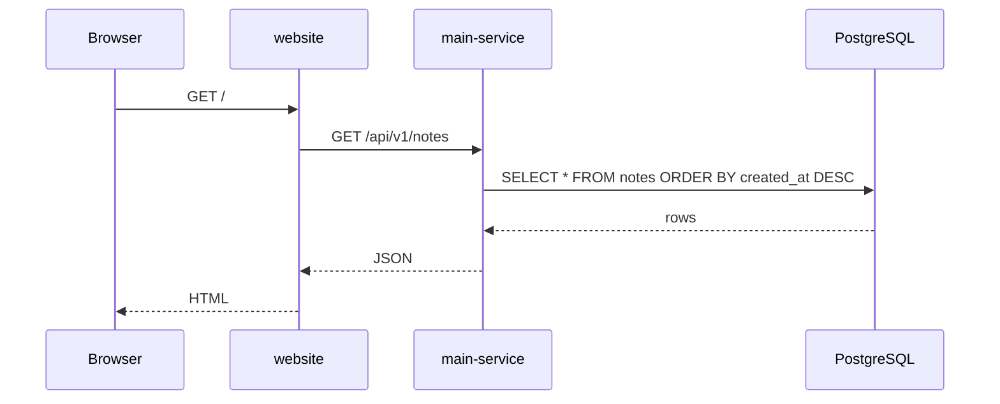

# Architecture

## Services

Three services, each in its own folder, each with its own spec under
`docs/`.

## Networks

- **Dev**: `main-network-dev`. Backend + bot run in Docker; the website
  runs on the host via `npm run dev`. No proxy — ports are published
  directly.
- **Prod**: `main-network`. Everything containerised behind Traefik.

The two networks are separate, so both stacks can run side-by-side
without collisions. See `docs/DEV.md` for the dev workflow.

## Boundaries

- **main-service** — owns `main_db`, runs Alembic migrations.
- **website** — Next.js. Calls the API through the `/api/*` rewrite.
  Never touches the DB.
- **tg-bot** — long-polling bot.

## Website is prod-only in Docker

The website `Dockerfile` builds a standalone Next.js server and is used
**only** by the root `docker-compose.yml` (prod). In dev, the site runs
on the host with `next dev` — Docker is not involved.

If you are adding a feature to the website, do not add it to
`docker-compose.dev.yml`. It will not be picked up. Run `npm run dev`
locally.

## Adding a service

Rarely needed. Only when the new concern has its own scaling profile, its
own team, or its own release cadence. Otherwise, add a module to an
existing service.

If you do add one:

1. Create `backend/services/<name>/` mirroring `main-service/`.
2. Add `docs/<name>/` with `AGENTS.md`, `README.md`, `spec.md`.
3. Register it in `backend/docker-compose.yml`,
   `backend/docker-compose.dev.yml`, and the root includes.
4. Wire it into the diagram above.

## Data flow

## Roadmap of what's not here yet

Nothing on this list is forbidden — it's simply not in the base because
every project needs a different subset. Add it in its own module when a
feature actually needs it:

- auth (JWT, sessions, OAuth) — its own `app/auth/` + `schemas/auth/`
- file uploads — a `files` resource + a storage adapter
- background jobs — a `tasks/` module + a broker
- real-time — websockets in `main.py` or a separate service
- payments — a `billing` resource + a provider adapter
- search — a `search` module or a separate service
- i18n — `next-intl` on the frontend, a header on the backend

Each of these follows the same pattern as `notes`: spec → code → test.
