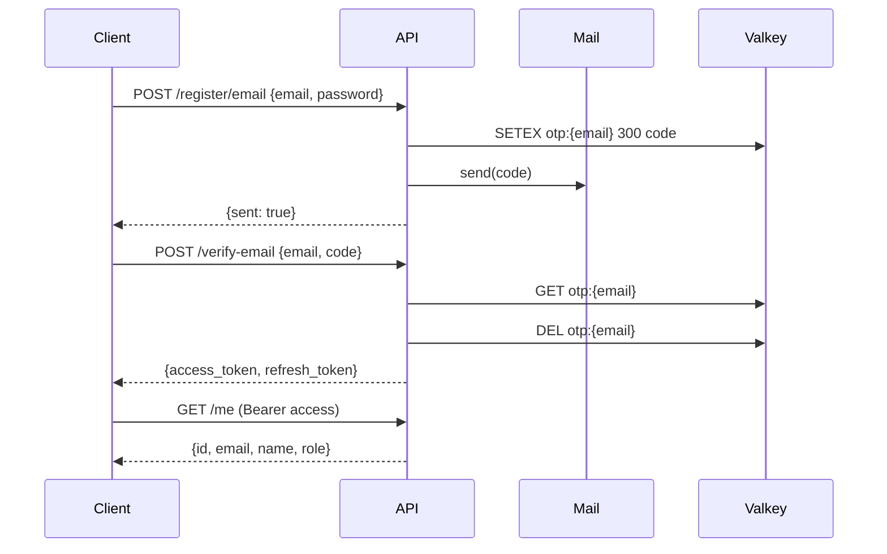

# main-service — Spec

Source of truth for user identity and content.

## DB schema

See [`main-service.dbml`](./main-service.dbml). It is authoritative — if
the spec and the .dbml disagree, the .dbml wins until both are fixed.

## Endpoints

### Auth (`/api/v1`)

| Method | Path                   | Auth | Purpose                          |
|--------|------------------------|------|----------------------------------|
| POST   | `/register/email`      | —    | Start signup, send OTP           |
| POST   | `/verify-email`        | —    | Confirm OTP, return JWT pair     |
| POST   | `/resend-verification` | —    | Resend OTP                       |
| POST   | `/login/email`         | —    | Email + password login           |
| POST   | `/refresh`             | —    | Refresh token → new access token |
| POST   | `/logout`              | user | Invalidate refresh token         |
| GET    | `/me`                  | user | Current user profile             |

### Me (`/api/v1/me`)

| Method | Path               | Auth | Purpose         |
|--------|--------------------|------|-----------------|
| PATCH  | ``                 | user | Update profile  |
| POST   | `/change-password` | user | Change password |

### Admin (`/api/v1/admin`)

All routes require `get_admin_user` (role `admin` or `root`).

## Error format

- `4xx` from validation → FastAPI default `{"detail": [...]}`.
- All other errors → `{"message": "..."}`.

## Rate limits

- Global: 200 req/min per IP (`config/rate_limiter.py`).
- OTP cooldown: 5s per IP.

## Auth flow

## Env vars

Required: `MAIN_DB_*`, `CACHE_*`, `JWT_SECRET_KEY`, `MAIL_*`,
`ALLOWED_ORIGINS`. See `.env.example` at repo root.
