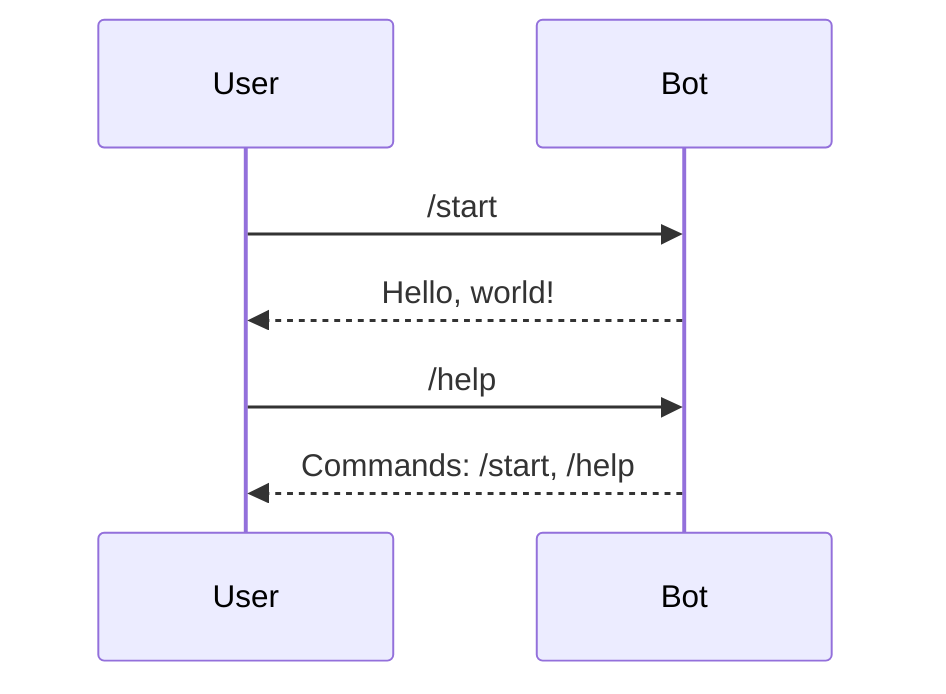

# tg-bot — Spec

Minimal aiogram 3 bot. Long polling. Hello world only.

## File layout

```
tg-bot/
  app/bot.py          the whole bot
  Dockerfile
  docker-compose.yml  prod stack
  requirements.txt
```

The bot is **stateless**. No database, no FSM, no sessions to maintain.

## Behaviour



## Adding the first command

1. Add a handler in `app/bot.py`:
   `@dp.message(Command("ping"))`.
2. Reply with `await message.answer("pong")`.
3. Register the command with `bot.set_my_commands([...])` in `main()` so
   it shows in Telegram's menu.
4. Update this spec.

## Adding state (when needed)

Only if a flow needs multiple steps:

```python
from aiogram.fsm.state import State, StatesGroup

class Form(StatesGroup):
    waiting_name = State()
```

Use `MemoryStorage` (already wired in `main()`). Never persist FSM state
to a database in this template.

## Env vars

| Var                  | Required | Purpose        |
| -------------------- | -------- | -------------- |
| `TELEGRAM_BOT_TOKEN` | yes      | from BotFather |

Nothing else is needed to run. Add `MAIN_SERVICE_URL` and a shared secret
if the bot ever needs to call the backend.
