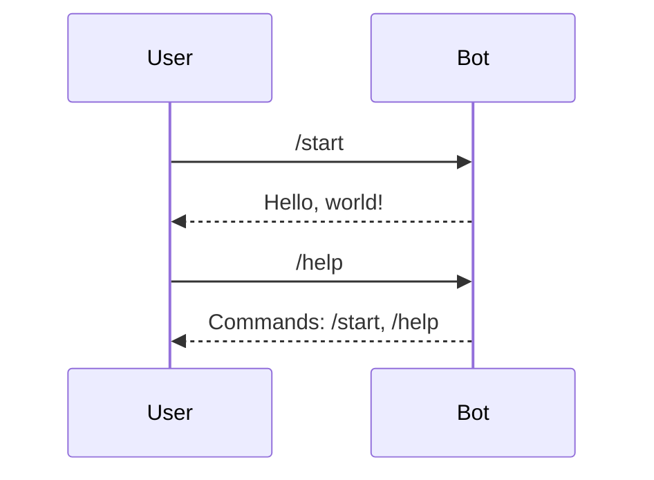

# tg-bot — Spec

Minimal aiogram 3 bot. Long polling. Hello world in the base so the
whole pipeline (poll → dispatch → reply → command registry) is
demonstrated. Add handlers when a feature needs them.

## File layout

```
tg-bot/
  app/bot.py          the whole bot (until it outgrows one file)
  Dockerfile
  docker-compose.yml  prod stack
  docker-compose.dev.yml
  requirements.txt
  tests/              pytest suite
```

The bot is stateless in the base. Add state (DB, FSM, cache) in its own
module when a feature needs it.

## Behaviour



## Adding a command

1. Add a handler in `app/bot.py`: `@dp.message(Command("ping"))`.
2. Reply with `await message.answer("pong")`.
3. Register it in `main()` via `bot.set_my_commands([...])`.
4. Add a test in `tests/`.
5. Update this spec.

## Adding state (when needed)

Use FSM for multi-step flows:

```python
from aiogram.fsm.state import State, StatesGroup

class Form(StatesGroup):
    waiting_name = State()
```

`MemoryStorage` is fine for a single-process bot. For persistence across
restarts, add a Redis storage — spec it here when you do.

## Adding backend calls

Call `main-service` over HTTP with `httpx.AsyncClient`. Put the client in
`app/api.py` and inject it into handlers. Do not import SQLAlchemy — the
bot does not own the schema.

## Env vars

| Var                  | Required | Purpose                                   |
|----------------------|----------|-------------------------------------------|
| `TELEGRAM_BOT_TOKEN` | yes      | from BotFather                            |

Add `MAIN_SERVICE_URL`, `MAIN_DB_*`, `CACHE_*` etc. as features require.

## Tests

`pytest -q`. Handlers are called directly with a mocked message.
