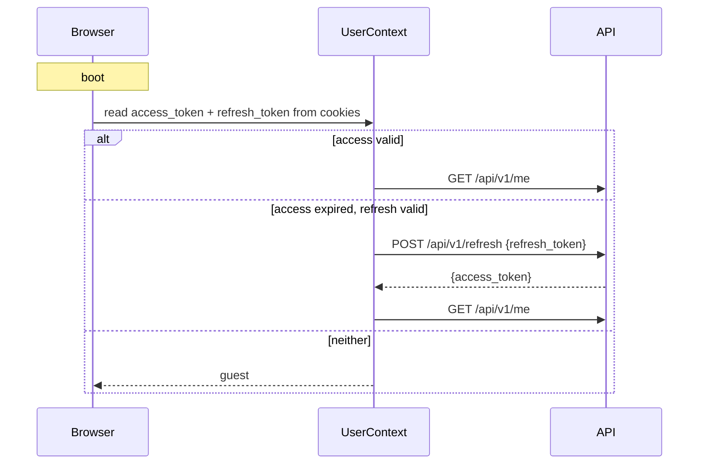

# website — Spec

Server-rendered frontend: public site, login, and protected `admin.*` /
`app.*` areas.

## Route map

| Path              | Group          | Auth       | Renders              |
|-------------------|----------------|------------|----------------------|
| `/`               | —              | none       | Landing              |
| `/login`          | —              | guest only | Email/password login |
| `/admin/[secret]` | `(Subdomains)` | admin/root | Admin dashboard      |
| `/app/profile`    | `(Subdomains)` | user       | Profile editor       |

### Conventions

- Subdomain folders live under `app/(Subdomains)/<name>/`.
- Each subdomain has `layout.tsx` (server) + `client-layout.tsx` (client).
- Route protection via `<CheckUser>` / `<CheckNotUser>` from
  `entities/user/model/`.

## Auth model



Cookie names (`utils/safe-cookie-storage.ts`):

- `access_token` — JWT, 15 min TTL
- `refresh_token` — JWT, 7 day TTL

## Data fetching

`utils/fetch.ts → $fetch()`:

- Adds `Authorization: Bearer <access_token>`.
- Parses JSON safely.
- Shows a `sonner` toast on error unless `isToast: false`.
- Returns `{ response, json }` — callers check `response.ok`.

## Design tokens

Semantic CSS variables in `app/globals.css`:

```
--primary, --on-primary
--bg, --card, --outline
--on-bg-high, --on-bg-medium, --on-bg-low
--primary-glass, --state-hover
```

Tailwind reads them via `@theme inline`. Never hardcode hex.
